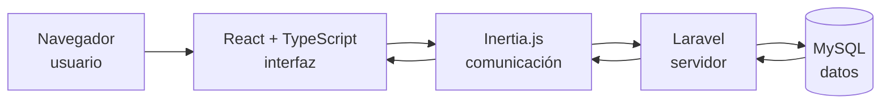
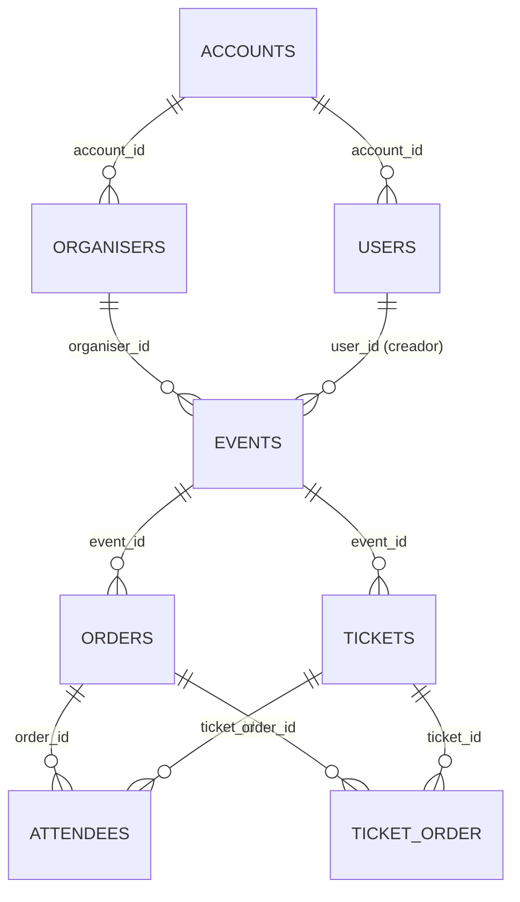

# 04 · Arquitectura objetivo y datos

## 1. Diagrama (Mermaid; exportar a imagen para el PDF)

## 2. Responsabilidades

| Elemento | Responsabilidades |
|---|---|
| Navegador | Mostrar la página y recoger las acciones de la persona (clics, teclado, formularios). |
| React con TypeScript | Construir las pantallas y componentes; validar los datos en el cliente con tipos para detectar errores antes de enviar. |
| Inertia.js | Conectar React con Laravel sin una API separada: envía los formularios y navegaciones al servidor y recibe los datos para pintar la pantalla. |
| Laravel | Comprobar permisos, validar y procesar los datos, aplicar las reglas (cupo, duplicados) y decidir la respuesta. |
| MySQL | Almacenar de forma persistente eventos, entradas e inscripciones, y devolver los datos consultados. |

## 3. Recorrido conceptual: «inscribirse a un evento»
1. La persona rellena el formulario en la pantalla y pulsa «Inscribirme».
2. React comprueba los campos básicos y entrega los datos a Inertia.js.
3. Inertia.js envía la petición a Laravel.
4. Laravel comprueba que el evento existe y está publicado, que quedan plazas y que los datos son válidos.
5. Laravel guarda la inscripción en MySQL (o rechaza con errores).
6. MySQL confirma el almacenamiento.
7. Laravel devuelve el resultado mediante Inertia.js y React muestra la confirmación o los errores.

## 4. Tratamiento de datos

Fuente: `DESCRIBE` de la base de datos de Attendize v2.8.0 desplegada en la Tarea 1 (tablas `events`, `tickets`, `attendees`, `orders`, `ticket_order`, `users`, `organisers`).

### 4.1 Entidades y relaciones (esquema real)

Hallazgos del esquema que condicionan el diseño:
- **Una inscripción no es solo un «asistente»**: `attendees.order_id` es obligatorio, así que cada inscripción crea un **pedido** (`orders`), un **asistente** (`attendees`) y un vínculo en `ticket_order`. Se mantiene este modelo (con pedido de importe 0,00) para conservar compatibilidad con los datos antiguos.
- **El organizador son dos cosas**: la persona que inicia sesión (`users`) y la entidad que firma el evento (`organisers`, obligatoria en `events.organiser_id`). En el alcance, un usuario trabaja con un organizador de su cuenta.
- **No existe tabla de roles**: `users` solo tiene `account_id` e `is_parent` (propietario de la cuenta). Los permisos (RF-10) se basan en pertenecer a la misma cuenta (`account_id`). El perfil «Administrador» se limita a `is_parent = 1`.
- **Cupo opcional**: `tickets.quantity_available` admite `NULL` (= sin límite). La versión nueva exigirá un valor.
- **Plazas libres** = `quantity_available − quantity_sold`; `quantity_sold` debe actualizarse en la misma transacción que la inscripción.
- **Borrado lógico**: `events`, `tickets`, `attendees`, `orders`, `users` y `organisers` tienen `deleted_at`; las consultas y la comprobación de duplicados deben ignorar las filas con `deleted_at` informado y las inscripciones con `is_cancelled = 1`.
- **Sin restricción única** de correo por evento en `attendees` (solo hay índices): el control de duplicados lo hará Laravel y, opcionalmente, un índice adicional.

### 4.2 Tabla de correspondencia entre datos antiguos y nuevos

| Tabla.campo (Attendize v2.8.0) | Uso en la versión modernizada | Acción |
|---|---|---|
| `events.title` (varchar 255, obligatorio) | Título del evento | Conservar; validar máx. 150 |
| `events.description` (text, obligatorio) | Descripción | Conservar; texto sin HTML peligroso |
| `events.venue_name` (obligatorio) | «Lugar» del formulario | Conservar. El resto de campos `location_*` no se usan en el alcance |
| `events.start_date` / `end_date` (datetime, admiten NULL) | Fecha de inicio / fin | Transformar: inicio obligatorio y futuro; fin posterior al inicio |
| `events.is_live` (0/1) | Publicado / despublicado | Conservar (despublicar = `is_live = 0`) |
| `events.organiser_id`, `user_id`, `account_id` | Organizador, creador y cuenta | Conservar; se rellenan desde la sesión |
| `events.bg_*`, `ticket_*_color`, `social_*`, `barcode_type`, `*_message`, `enable_offline_payments`… | — | Fuera de alcance: se mantienen los valores por defecto |
| `tickets.title` | Nombre de la entrada | Conservar |
| `tickets.quantity_available` (admite NULL) | Cupo | Transformar: obligatorio, entero 1–1000; NULL antiguo se revisa (ver 4.4) |
| `tickets.quantity_sold` | Plazas ocupadas | Conservar; se incrementa al inscribir |
| `tickets.price` (obligatorio) | Precio | Fijo en 0,00 (solo entradas gratuitas) |
| `tickets.description` (obligatorio) | Descripción de la entrada | Conservar (valor por defecto si el formulario no la pide) |
| `tickets.min/max_per_person`, `is_paused`, `is_hidden`, `start/end_sale_date` | — | Fuera de alcance: valores por defecto |
| `attendees.first_name`, `last_name`, `email` | Datos de la inscripción | Conservar y validar |
| `attendees.private_reference_number` (varchar 15) | Referencia privada | Conservar |
| `attendees.order_id`, `event_id`, `ticket_id`, `account_id` | Relaciones | Conservar |
| `attendees.is_cancelled`, `deleted_at` | Estado de la inscripción | Conservar; se excluyen de listados y cupo |
| `attendees.has_arrived`, `arrival_time`, `is_refunded` | — | Fuera de alcance (check-in y devoluciones) |
| `orders.order_reference` (varchar 15) | **Código de inscripción** mostrado en la confirmación | Conservar y generar único |
| `orders.first_name`, `last_name`, `email` | Datos de quien se inscribe | Conservar (iguales a los del asistente) |
| `orders.amount`, `order_status_id`, `is_payment_received` | Importe 0,00 y estado completado | Transformar: valores fijos para entradas gratuitas |
| `orders.business_*`, `transaction_id`, `payment_*`, `booking_fee`, `taxamt`, `discount`… | — | Fuera de alcance |
| `ticket_order.order_id`, `ticket_id` | Vínculo pedido–entrada | Conservar |
| `organisers.name`, `email` (obligatorios) | Organizador del evento | Conservar |
| `organisers.*` (colores, redes, analítica, impuestos) | — | Fuera de alcance |
| `users.email`, `first_name`, `last_name`, `account_id`, `is_parent` | Identidad y permisos | Conservar |
| `users.password`, `remember_token`, `api_token`, `confirmation_code` | Credenciales | **No se leen ni se migran**; las gestiona Laravel tal como están |

### 4.3 Validaciones

| Dato | Regla |
|---|---|
| Título del evento | Obligatorio, máx. 150 caracteres (la BD admite 255) |
| Descripción y lugar | Obligatorios (restricción `NOT NULL` de la BD) |
| Fecha de inicio | Obligatoria y futura al crear; fin, si existe, posterior al inicio |
| Cupo | Entero entre 1 y 1000 |
| Nombre y apellidos | Obligatorios, máx. 255 caracteres |
| Correo | Obligatorio, formato válido, máx. 255 |
| Inscripción | El evento debe estar publicado, la entrada no pausada y quedar plazas (`quantity_available − quantity_sold > 0`) |
| Duplicados | No puede haber dos inscripciones activas con el mismo correo en el mismo evento |

### 4.4 Reglas para valores incompletos o duplicados
- **Cupo `NULL` en datos antiguos**: no se interpreta como infinito; la entrada se marca para revisión y no admite nuevas inscripciones hasta que el organizador indique un cupo.
- **Correo vacío o con formato inválido** en `attendees`: no se migra la fila a ningún listado nuevo; se anota en un informe de migración.
- **Duplicados** (mismo `email` y `event_id`, activos): se conserva el más antiguo y el resto se anota en el informe.
- **Fecha de inicio ausente**: el evento se trata como borrador (`is_live = 0`).
- **`order_reference` repetido**: se regenera para el nuevo registro y nunca se reutiliza.
- **Registros con `deleted_at` o `is_cancelled`**: se conservan sin cambios y se excluyen de listados y del cálculo de plazas.
- **Antes de cualquier cambio de datos**: volcado de la base (`mysqldump`) y prueba sobre una copia.
